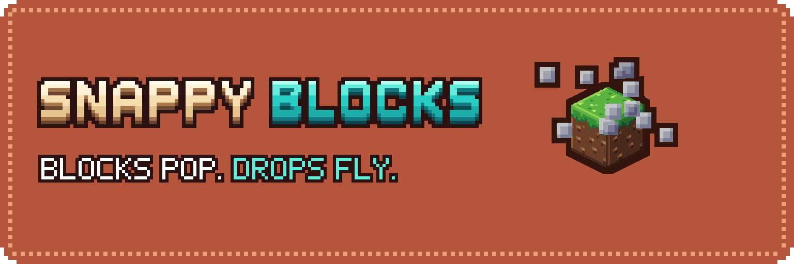

**Nothing blinks in or out anymore.** Snappy Blocks makes blocks pop into place, burst into their drops, and lets the drops bounce, settle and fly into your hotbar. A client-side mod for Minecraft Java 26.3, 26.2, 1.21.1 and 1.20.1 on Fabric, Quilt, NeoForge and Forge, so it works on any server.

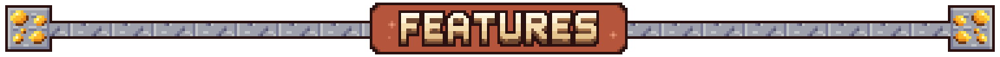

- **Placing.** A block pops into place with a small overshoot.
- **Mining.** The block pulses on every hit and the crack grows with it.
- **Breaking.** The block takes a punch, shrinks away and throws chips. The drop springs out of its centre.
- **Drops.** They squash and hop when they land, with a soft step sound. Stacks slide together when they merge and shrink out when they despawn.
- **Q-throw.** Thrown items start at your hand and grow out of it.
- **Pickups.** Items arc into your chest, or fly into the hotbar slot they land in.
- **Denied actions.** A placement or break the server refuses regrows or shrinks back instead of snapping.

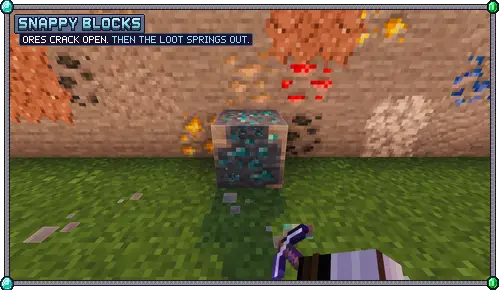
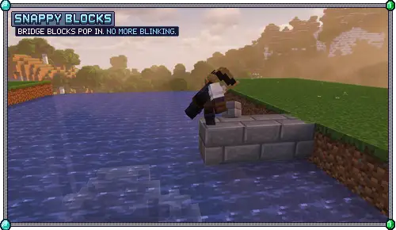
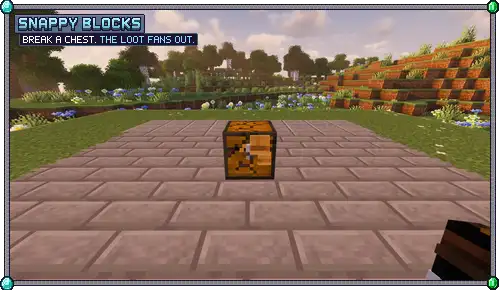
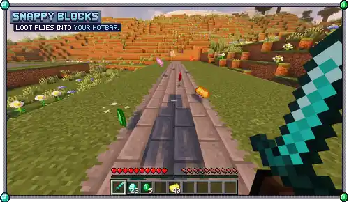

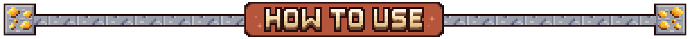

Install it and play. Nothing to press and nothing to learn.

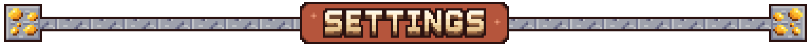

Edit `config/snappy_blocks.json` in your game folder. It has a switch for each effect, an intensity from 50 to 150, and **Calm** for reduced motion (smaller movement, no hit-stop, no hop). Every timing is a number in the same file, and changes apply while the game is running.

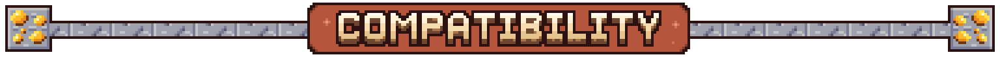

- **Client-side only.** Works on any server, including vanilla servers and Realms.
- Plays along with Sodium, Iris shaders, Continuity, Flashback re-shoots and Build Buddy.
- Mods that already animate the same thing (A Good Place, ItemPhysic Lite, Tiny Pickup Animation, Block Motion) make that effect stand aside, so nothing is doubled.

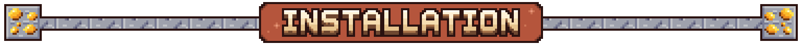

Put the jar for your Minecraft version and loader in your `mods` folder: 26.3, 26.2, 1.21.1 or 1.20.1 on Fabric, Quilt, NeoForge or Forge (the Fabric jar also loads on Quilt; on 1.20.1 NeoForge uses the Forge jar). It does not need Fabric API. Sodium is supported (0.9 on 26.3 and 26.2, 0.8 on 1.21.1, 0.5 on 1.20.1); with Embeddium or Rubidium the place pop stands aside and everything else stays. Iris shaders are supported on all four versions (tested with Complementary and BSL): growing blocks are lit like placed ones and cast their shadow. Other players' mining pulses show on 26.3 only.

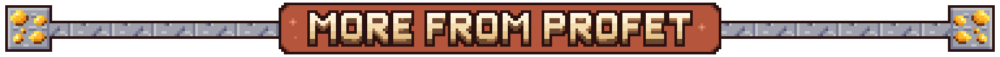

<!-- promo:start -->

<!-- promo:end -->

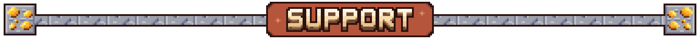

Snappy Blocks is free. If it makes your world feel better to build in, a coffee helps fund the next update.

Want your own server to play on with friends? My BisectHosting affiliate link gives you 25% off the first month, and I get a small commission.

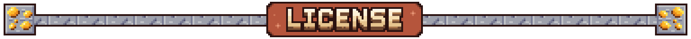

All rights reserved; see [LICENSE](https://github.com/ProfetGit/snappy-blocks/blob/main/LICENSE).

Not an official Minecraft product. Not approved by or associated with Mojang or Microsoft.

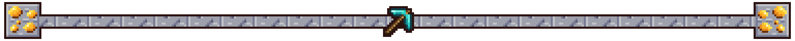
